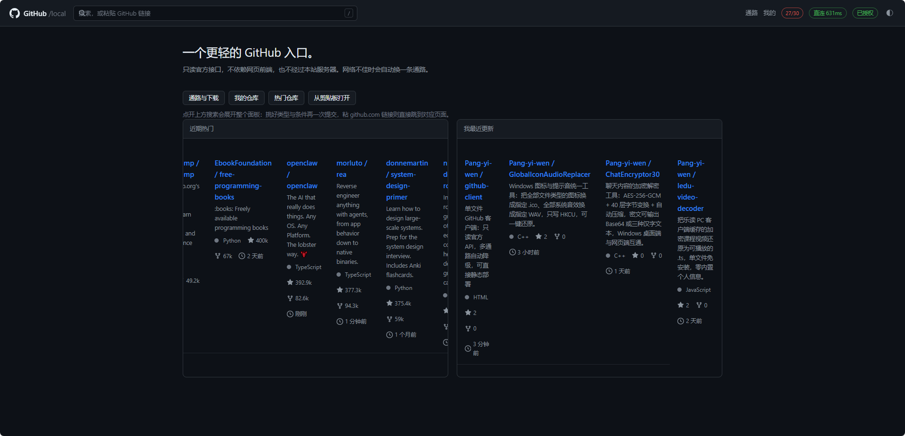
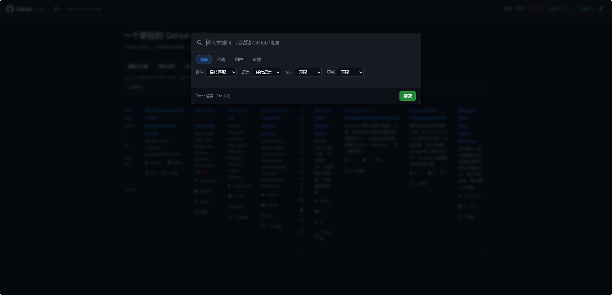
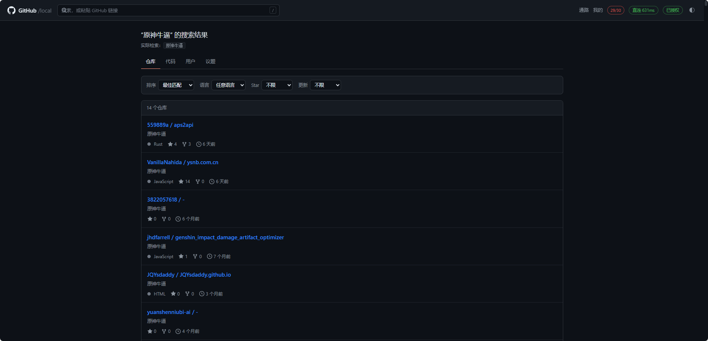

# GitHub 客户端

GitHub 只读客户端。单个 HTML 文件，无需安装或构建，可直接在浏览器中打开，也可部署为静态站点。



> 截图取自早期版本，与当前界面存在差异，以实际页面为准。

## 特性

**单文件**
样式、脚本与依赖全部内联，无构建步骤，界面加载不依赖外部请求。

**体积**
单页小于 1 MB。

**多通路**
不请求 github.com 的页面资源，仅调用 `api.github.com` 与 `codeload.github.com`。
三条通路按探测延迟排序，主通路失败时依次切换。

**无需代理**
页面与接口走公开 CDN 与镜像通道，国内网络直连可用，不依赖 VPN / 代理工具，也不改动系统网络设置或 hosts。

**下载速度**
安装包与发行版资产提供六条通道：jsDelivr CDN、GitHub 发行版直链、ghfast.top、gh-proxy.org、ghproxy.net、raw 直连，在下载对话框里任选。移动网络下实测 jsDelivr 与 ghfast.top 约为 1–2 MB/s；同一文件在浏览器里直接下载时常见数十 KB/s。

**请求开销**
文件正文与 README 图片经 raw 通道获取，不计入 API 配额；缓存有效期内不重复请求。
浏览单个仓库通常消耗 3 次接口调用。

**无服务端**
无后端进程、数据库与配置文件，可直接部署为静态站点运行。

**只读**
不提供写操作，令牌无需写权限。凭据仅存储于浏览器本地，不经过中间服务器。
如需写入，可在设置中单独启用，见「写操作」。

**本地收藏**
仓库页的「☆ 本地收藏」只写入本机 `localStorage`，不调用 GitHub，不进入公开的 Stars 列表；与 GitHub Star 相互独立。

**搜索历史**
检索记录存于本机，可在搜索面板里重跑、改名、删除或清空；不上传。

**通知提醒**
评论被回复、被 @、被指派或订阅的议题有新动静时，顶栏铃铛显示未读数，新通知到达时提醒；列表页可就地标记已读。

## 通知提醒

读取 `GET /notifications` 的未读列表，按固定间隔检查，默认 5 分钟，设置里可改为 1–30 分钟。出现新条目时提醒，顶栏铃铛显示未读数，点击进入列表页。

| 触发原因 | 含义 |
| --- | --- |
| comment | 你参与的讨论有新回复 |
| mention | 有人 @ 你 |
| reply | 回复了你的评论 |
| review_requested | 请求你评审 |
| assign | 指派给你 |
| state_change | Issue / PR 状态变更 |
| team_mention | 提到了你所在的团队 |
| security_alert | 安全提醒 |

列表页按仓库分组，点击条目跳到对应 Issue / PR / 提交并自动标记该条已读，也可整仓或全部标为已读。标记已读属于写请求，只发给直连或自建通道。

首次启用只记录基线，历史未读不会一次性全部弹出。已提醒过的通知 id 存于本机，保留 7 天，重复检查不会重复提醒。令牌需要 `notifications` 作用域，缺了它接口返回空列表，此时列表页会给出提示。

网页端的浏览器通知需在设置里授权，`file://` 打开时不可用；客户端内改由系统通知发出，Android 13 及以上首次启动会申请通知权限。

## 写操作

默认关闭。在设置中启用后，仓库页与「我的」页会出现相应入口：

| 功能 | 位置 | 需要 |
| --- | --- | --- |
| Star / 取消 Star | 仓库页标题下 | 令牌含 `repo` 作用域（他人可见） |
| Fork | 仓库页标题下 | 令牌含 `repo` 作用域 |
| 上传文件 | 仓库页标题下 | 该仓库的写权限 |
| 新建仓库 | 「我的」页 | 令牌含 `repo` 作用域 |
| 新建 Issue / PR | 议题与 PR 列表页 | 令牌含 `repo` 作用域 |
| 发表评论 | Issue / PR 详情页底部 | 该仓库的写权限 |
| 关闭 / 重新打开 | Issue / PR 详情页底部 | 该仓库的写权限 |
| 新建 / 删除 Gist | Gist 页与详情页 | 令牌含 `gist` 作用域 |
| 新建 / 删除发行版 | 发行版页 | 该仓库的写权限 |
| 删除仓库 | 仓库页，需管理员权限 | 令牌含 `delete_repo` 作用域 |

删除仓库不可逆，需输入 `owner/repo` 全名确认。用户主页在识别为本人时会改用 `/user/repos`，因此私有仓库与写操作入口都会出现。

写请求只发给直连或自建通道。当前仅有公共中转可用时，写操作会被拒绝并提示，因为明文令牌不应交给第三方。

值得区分的是：**开源的是仓库内容，令牌代表账号权限**。带 `repo` 作用域的令牌能读写名下全部仓库（含私有）、删除仓库、修改资料，权限范围远大于任何一个对外公开的仓库。中转服务能看到请求头里的 `Authorization` 字段，拿到该字符串即可行使这些权限，与其经手的仓库是否公开无关。

因此若已配置令牌而当前通道显示为黄色（公共中转），顶栏徽标的提示会说明令牌正在被该服务转发。需要避免时，请使用直连或自建通道。

上传按 UTF-8 文本读入，同名文件会被覆盖；新建 PR 时来源分支需已存在于该仓库，跨 fork 的 PR 不在本页支持。Issue 与 PR 共用同一套 `issues` 端点，因此状态变更对两者都有效。新建发行版时若标签不存在，会基于所填分支创建；删除发行版不会删除对应的 Git 标签。附件上传未实现。

## 与其他方案对比

| 方案 | 说明 |
| --- | --- |
| 官方网页 | 依赖较多前端资源，网络不佳时无法加载 |
| 桌面客户端 | 需安装与更新，占用空间较大 |
| 命令行 `gh` | 功能完整，终端内无语法高亮与排版 |
| 第三方镜像站 | 由第三方运营，可用性不受控，中间过程不可审计 |
| 本项目 | 单个静态文件，自行托管，源码可查 |

## 搜索

顶栏搜索展开为独立面板，类型与筛选条件在面板内一次设置。



四类结果的条件分别如下，条件写入 URL，刷新与分享均保留：

| 类别 | 可调条件 |
| --- | --- |
| 仓库 | 排序（Star / Fork / 更新 / 待协助）、语言、Star 下限、更新时间 |
| 代码 | 语言、限定仓库 `owner/repo`、路径前缀；命中片段内高亮关键词 |
| 用户 | 排序（关注者 / 仓库数 / 加入时间）、用户或组织、仓库数下限 |
| 议题 | 排序、状态、仅议题或仅 PR、标签 |

结果页显示实际提交给 API 的检索式，用于核对条件：



输入 `github.com` 链接时直接跳转至对应页面，不执行检索：

| 链接 | 目标 |
| --- | --- |
| `github.com/o/r` | 仓库首页 |
| `.../blob/<分支>/<路径>` | 文件 |
| `.../tree/<分支>/<路径>` | 目录 |
| `.../issues`、`.../issues/12` | 议题列表 / 议题 |
| `.../pulls`、`.../pull/34` | PR 列表 / PR |
| `.../releases`、`.../commits`、`.../branches`、`.../commit/<sha>` | 对应标签页 |
| `github.com/<用户>` | 用户主页 |
| `raw.githubusercontent.com/...` | 文件 |

链接可省略协议。首页提供「从剪贴板打开」入口。

### 搜索历史

每次检索记一条，含关键词、类型与筛选条件，存在本机 `localStorage`，上限 30 条。相同条件重复搜索只把该条提到最前，不新增。

搜索面板底部列出全部历史：点击条目按原条件重跑，「编辑」原地改关键词、回车即用新词重跑，「删除」去掉单条，「清空」全部清除。首页显示最近 6 条，点击直达结果页。设置面板里可查看条数并清空。

粘贴的 github.com 链接是一次跳转，不记入历史。

## 翻译

大段文字（仓库介绍、issue / PR 正文、评论、发行说明）超过阈值时显示「译成中文」按钮，翻译后可切换回原文。

六条通道，按顺序尝试，前一条失败自动换下一条：

| 通道 | 说明 |
| --- | --- |
| 浏览器内置翻译模型 | Chrome 138+ / Edge，本地运行，无请求次数限制，内容不出本机 |
| 腾讯翻译 | 公共接口，无需配置，单次可处理数千字符，支持批量 |
| B 站 Index-Translate | 公共接口，免密钥，OpenAI 兼容，单条可处理长文本 |
| Pollinations | 公共接口，AI 翻译，单条耗时数秒 |
| 自建 LibreTranslate | 可选，在设置中填入地址与 API Key |
| MyMemory | 公共接口，兜底用，500 字符/次、约 5000 字符/天 |

设置面板中可指定优先通道，其余通道仍保留为兜底；`自建 LibreTranslate` 需同时填写地址，服务要求鉴权时再填 API Key。

百度、有道、搜狗、Lingva 及多个 LibreTranslate 公共实例均已尝试，或因响应缺少 `Access-Control-Allow-Origin` 而无法在浏览器内读取，或服务已下线，未纳入。

译文按「仓库@分支」缓存，同一仓库只翻译一次。自建 LibreTranslate 可在设置中填入地址。

翻译仅作用于正文段落；代码块、链接地址与表格分隔符保持原样。

## 通路

请求按顺序尝试，任一失败则切换下一条：

| 通路 | 地址 | 前提 |
| --- | --- | --- |
| 直连 | `api.github.com` | 网络可达 GitHub |
| 自建 | 自填，见 `worker.js` | 有自己的 Cloudflare Worker 或反代 |
| 公共 | `gh-proxy.org` → `gh-proxy.com` | 无需配置；额度由该站共享，可能已耗尽 |

文件内容与 README 图片另走 raw 通道（`raw.githubusercontent.com` → `gh-proxy.org` → `gh-proxy.com` → `ghfast.top` → API 二进制），不占 API 额度。API 完全不可用时，已加载过的仓库文件仍可读取。

探测端点使用 `/rate_limit`，不消耗额度。顶栏徽标显示当前通路与延迟，绿色表示直连或自建，黄色表示公共中转。

## 本地缓存

响应内容存储于 `localStorage`，有效期内不重复请求，因此不消耗配额。

| 内容 | 有效期 |
| --- | --- |
| 文件、目录、搜索 | 5–10 分钟 |
| 提交、议题、PR | 4–5 分钟 |
| 仓库信息 | 8 分钟 |
| 发行版、分支 | 15 分钟 |
| 用户主页 | 20 分钟 |
| README | 30 分钟 |

更换令牌会清空缓存（可见范围变化）。设置面板显示缓存条数，可手动清空。

## 自动更新

构建时把 `VERSION` 文件的内容内联为 `APP_VERSION`。运行时每隔最多 6 小时读取一次来源仓库的 `VERSION` 文件，发现较新版本时顶栏显示箭头徽标并提示，点击即更新。

| 场景 | 更新方式 |
| --- | --- |
| http(s) 部署 | 拉取最新 `GitHub.html`，热替换当前文档 |
| file:// 本地打开 | 下载最新 `GitHub.html`，替换原文件后重新打开 |

版本读取优先走 raw 通道，不占 API 额度；raw 全部不可用时改走 API。检查时间记录在本地，间隔内不重复请求。自动检查失败不提示，仅在确认存在新版本时提醒。

设置面板可关闭自动检查、立即手动检查，或指定其他更新源（`owner/repo`，供 fork 使用）。版本号按点分段做数值比较，`1.2.0` 低于 `1.10.0`。

发版流程：修改 `VERSION` → `node build.js` → 提交并推送。

## 用法

首次使用需配置访问令牌（右上「未授权」）。设置面板提供 GitHub 令牌生成页入口（勾选用途后链接自动带上作用域，默认 `public_repo,notifications`；读取私有仓库需 `repo`），也可复制 `gh auth token` 命令在终端获取已有令牌。收通知提醒另需 `notifications` 作用域。写操作另需 `repo`，删除仓库需 `delete_repo`（该项独立于 `repo`，GitHub 不会自动包含），Gist 需 `gist`。

| 项 | 匿名 | 带令牌 |
| --- | --- | --- |
| 核心接口额度 | 60 次/小时 | 5000 次/小时 |
| 代码搜索 | 不可用 | 可用 |
| 私有仓库 | 不可用 | 可用 |

已实现：仓库浏览、目录树、文件查看与语法高亮、README 渲染、Markdown 预览、语言占比、Issue / PR 只读、评论正文、提交历史、发行版、分支、用户主页、Gist 浏览与创建、通知提醒与标记已读、按仓库生成下载与克隆地址。搜索结果、议题列表、提交历史支持翻页。

快捷键：`/` 或 `Ctrl+K` 打开搜索面板，`Esc` 关闭。

## 边界

- 默认只读，写操作需在设置中显式启用；启用后令牌需 `repo` 作用域，误操作会真实改动远端仓库。
- 通知检查按间隔请求 `/notifications`，计入每小时额度（匿名 60 次、带令牌 5000 次）；页面在后台时不轮询。
- 无后端。所有请求由浏览器直连 GitHub 或用户指定的中转，无中间服务器。
- 令牌存储于浏览器 `localStorage`，随请求发送至 GitHub。经公共中转时该服务可读取请求头，如需避免请使用直连或自建通道。以 `file://` 打开时，同一浏览器的其他本地页面亦可读取该令牌，长期使用建议部署为站点。
- 私有仓库与代码搜索依赖令牌权限；令牌需包含 `repo` 与 `read:org` 作用域。
- 单页小于 1 MB，依赖全部内联。

## 部署

纯静态，无构建步骤：

| 平台 | 做法 |
| --- | --- |
| Cloudflare Pages | 上传 `GitHub.html`，改名 `index.html` |
| Vercel / Netlify | 同上，或拖入整个目录 |
| 自有服务器 | 放入 web 根目录 |

### 自建中转

公共中转的额度不受控制，长期使用建议自建：

1. 在 Cloudflare 新建 Worker，粘贴 `worker.js` 内容并部署。
2. 复制 Worker 地址（`https://xxx.workers.dev/`）。
3. 填入客户端「设置 → 自建中转」并保存。

Worker 仅转发白名单内的 GitHub 域名，避免被用作开放代理；用户令牌原样透传，额度独立计算。

Nginx 亦可替代：将 `/https://api.github.com/...` 转发至上游，并补充 `Access-Control-Allow-Origin` 与 `Access-Control-Allow-Headers` 响应头。

## 安卓客户端

`android/` 目录是同一客户端的安卓外壳：WebView 加载内置的单文件页面，页面与网页版逐字节相同，功能无删减。

| 项 | 说明 |
| --- | --- |
| 包名 | `com.pangyiwen.ghclient` |
| 最低系统 | Android 7.0（API 24） |
| 通知 | 由系统通知栏发出，Android 8.0+ 建独立渠道；Android 13+ 需授予通知权限 |
| 构建 | 双击 `android/build-apk.bat`，产物为 `GitHubClient.apk` |
| 工具链 | 本机 `C:\build-mv47`（JDK 17 + Android SDK 36.1），不写注册表、不改 PATH |

两条更新通道，均从本仓库拉取：

| 通道 | 触发物 | 行为 |
| --- | --- | --- |
| 页面更新 | 仓库 `VERSION` 变化 | 弹窗确认后下载最新 `GitHub.html`，就地替换后刷新 |
| 安装包更新 | `android/apk/version.json` 的 versionCode 升高 | 弹窗确认后下载安装包，完成后自动调起系统安装器 |

安装包更新需要用户在系统设置中授予「安装未知应用」（Android 8.0+），首次更新时按提示引导开启。

安装包同时发布在 GitHub Releases，资产名与 `android/apk/version.json` 的 `apk` 字段一致；下载对话框里的「GitHub 发行版」通道指向 `releases/latest/download/<apk>`，始终解析到最新一版。

签名密钥位于 `android/ghclient.jks`（本地，不入库；已从构建目录迁出，清理 `build/` 不会使其重新生成），同一个包名覆盖安装必须使用同一密钥，遗失后无法原地升级，需单独备份。

## 构建

修改 `src/` 或 `vendor/` 后重新生成单文件：

```
node build.js
```

`VERSION` 文件的内容在构建时内联为 `APP_VERSION`，供自动更新比对，缺失时记为 `dev`。

## 文件

```
GitHub.html           成品，单文件，可直接部署
VERSION               版本号，构建时内联，自动更新据此比对
worker.js             Cloudflare Worker 中转
build.js              将 src 与 vendor 内联为单文件
src/shell.html        外壳模板
src/style.css         样式
src/app.js            应用逻辑
vendor/               marked、highlight.js
android/              安卓客户端工程（WebView 外壳）
android/apk/          已签名安装包与版本清单，供应用内更新拉取
docs/screenshots/     界面截图
scripts/push-api.js   git 通道不可用时经 API 推送（维护用）
```

界面色板取自 GitHub 官方设计系统 [Primer](https://primer.style)（`@primer/primitives`，MIT 许可）的 dark / light token。
